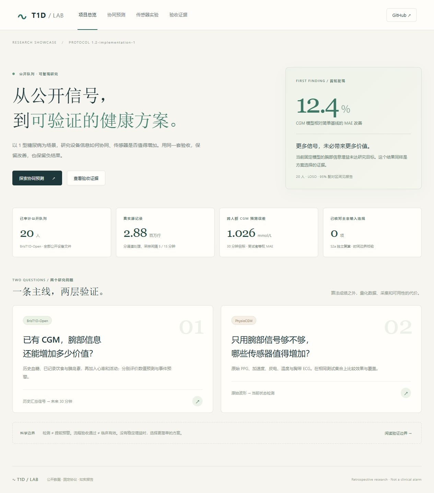

# T1D Wearable Lab

Two reproducible research modules on public type 1 diabetes cohorts:

1. **CGM + wearable collaboration:** 30-minute glucose forecasting and separately evaluated incident hypoglycemia prediction using BrisT1D-Open.
2. **Sensor evaluation:** current hypoglycemia detection, signal quality, and paired sensor ablations using PhysioCGM.

This repository is a retrospective research project. Protocol compliance, predictive effect, and presentation readiness are separate acceptance decisions. Negative results are retained. No original participant records or credentials are published here.

## Status

Both initial research pipelines have run on real public data and passed independent evaluation checks. See [stage acceptance](docs/acceptance/STATUS.md), the [Chinese validation report](docs/VALIDATION_REPORT.zh-CN.md), [metric definitions](docs/METRICS.zh-CN.md), and the [new improvement plan](docs/IMPROVEMENT_PLAN.zh-CN.md). Passing engineering checks does **not** mean the alarm targets passed.

The initial **20-subject LOSO** numeric comparison finds CGM-only MAE 1.0261 mmol/L versus 1.1710 for the validation-selected simple baseline. Adding wearable summaries to the context model did **not** improve this held-out comparison (1.0290 versus 1.0252 mmol/L). Temporal results differ and are reported separately. These are retrospective fixed-model results, not medical efficacy or a general impossibility claim. See [S2a evidence](docs/acceptance/S2a.json).

The separate incident-risk model reaches 47.5% subject-equal event recall at 0.53 unmatched alarms/person-day in LOSO, below the internal recall target. In the physiological module, 7/10 source clocks were eligible; the original five sensor configurations fail the event target, including zero event recall at their validation-selected test operating points. These negative results are retained while v2 explores personalized models, temporal features, and denser validation-only alarm selection. Reusing the already viewed cohort is explicitly exploratory.

**Improvement ledger:** additional PhysioCGM temporal/device-summary experiments still fail the event target. A separate public smartwatch cohort now shows an exploratory personalized **AP increase from 0.098 to 0.189** versus a clock-only baseline (8 positive-test subjects; paired difference 0.091, unadjusted 95% subject-bootstrap interval 0.002–0.184). AUC improvement remains uncertain. Processed source rows lack complete timestamps, so this is point classification with source-row holdout, **not confirmed future-time or event-alarm validation**. All 11 people, single-class test partitions and unseen-subject negative results are retained. See the [improvement report](docs/IMPROVEMENT_REPORT.zh-CN.md) and the site's improvement page.

The next [context and calibration experiment](docs/CONTEXT_REPORT.zh-CN.md) independently verifies 132 groups. On its identical test opportunities, adding diaries gives AP 0.103 versus wearable+clock 0.156, without stable incremental benefit. Validation calibration lowers raw Brier from 0.131 to 0.030, but the simple training-prevalence baseline is 0.028. This is score correction, not evidence that detection is solved. A wider support purge changes the test range, so these numbers must not be directly compared with the earlier 0.189.

A separate [expert-annotated ECG capture pilot](docs/ECG_CAPTURE_REPORT.zh-CN.md) verifies 48 groups on four fixed MIT-BIH records: existing energy-peak and default WFDB XQRS macro beat F1 are 99.66% and 99.77%. Both pass the internal capture gate. This is a small front-end signal check, not a PPG, hypoglycemia or clinical-alarm result; PhysioCGM extraction remains unchanged.

**Method/parameter follow-up:** six fixed regimes add activity residuals, nested chronological hyperparameter tuning, shared models, explicit alert policies and ECG failover. All336 test groups are independently verified. Supported-time coverage increases from72.8% to82.8%, but the predeclared primary detector still matches0/30 events. The secondary2/day validation budget matches2/30 at1.858 unmatched alerts/reference-person-day; it does not pass the primary target. Miss decomposition:3 events without input,26 never above the selected threshold,1 without an event-time alert. See the [design rationale](docs/METHOD_CHANGE_V3.zh-CN.md) and [complete v3 report](docs/MECHANISM_REPORT.zh-CN.md).



## Try the local showcase

Node 22 is recommended. The checked-in aggregate evidence and PNG/SVG cards work without patient-data downloads:

```powershell
cd showcase
npm ci
npm run dev
```

Open the printed local URL. The interface offers protocol comparisons, five sensor configurations, evidence drawers, PNG cards and aggregate JSON export. Optional real participant replays/waveforms are generated locally after analysis and excluded from Git. See the [three-minute demo script](docs/DEMO.zh-CN.md). Public site deployment and personal-device migration are outside the current scope.

## Setup

```powershell
python -m pip install -e ".[reports]" pytest
python -m pytest -q
python scripts/download_data.py --dataset brist1d
python scripts/download_data.py --dataset physiocgm
python scripts/audit_data.py --dataset brist1d
python scripts/run_module1.py --build-only
python scripts/run_module1.py --protocol both
python scripts/verify_module1.py
python scripts/extract_signals.py --watch
python scripts/run_incident.py
python scripts/verify_incident.py
python scripts/run_module2.py
python scripts/verify_module2.py
python scripts/robustness_report.py
python scripts/export_showcase.py
python scripts/export_signal_example.py
python scripts/export_cards.py
python scripts/final_report.py
```

The initial environment is pinned in `requirements-reproduce.txt`; the package also tests explicit datetime resolutions so pandas microsecond/nanosecond defaults cannot silently change time units. After a result changes, regenerate the aggregate JSON, cards and report together; display-contract tests enforce identical scientific values and a shared canonical run ID. Outputs and individual predictions remain local. Source file sizes/checksums are in [the source manifest](docs/source_manifest.json).

To run the separately versioned exploratory comparison, first read `configs/improvement_v2.json`, then run `python scripts/run_improvement.py`. Validation chooses candidates and alarm parameters; test predictions are not used to pick winners.

Download commands save data locally under ignored `data/`, verify source checksums where available, and write a local manifest. PhysioCGM is processed directly from per-subject raw ZIP archives to avoid duplicating the full corpus on disk. Dataset access, source availability, and terms remain those of the original repositories.

## Sources and licenses

- [BrisT1D-Open](https://data.bris.ac.uk/data/dataset/33z5jc8fa6tob21ptrugzqog08): processed device data, CC BY 4.0. [Schema](https://data.bris.ac.uk/datasets/33z5jc8fa6tob21ptrugzqog08/README.txt).
- [PhysioCGM](https://doi.org/10.6084/m9.figshare.28136294): raw physiological data and CGM, CC0. [Data descriptor](https://doi.org/10.1038/s41597-025-06090-6).
- [Smartwatch hypoglycemia processed data](https://doi.org/10.5281/zenodo.15309060): 11 published participant CSVs, CC BY 4.0, [Mohamed et al., PLOS ONE 2025](https://doi.org/10.1371/journal.pone.0325956). Download with `python scripts/download_data.py --dataset smartwatch_hypo`; different sensors and endpoints are evaluated separately.
- [MIT-BIH Arrhythmia v1.0.0](https://physionet.org/content/mitdb/1.0.0/), Moody & Mark, 2005, DOI [10.13026/C2F305](https://doi.org/10.13026/C2F305), ODC Attribution v1.0. Four fixed ECG records used only for capture validation. [WFDB Python 4.3.1](https://github.com/MIT-LCP/wfdb-python) is MIT-licensed; install the optional `signals` extra and follow the capture report.
- Own implementation: MIT. Public availability of an author's repository does not grant an unspecified code license; this project does not copy the original PhysioCGM implementation.

Published cohort sizes are not treated as counts of eligible test subjects. Each input file and exclusion is audited. CGM is a reference measurement, not a clinical venous-glucose gold standard. Detection is not advance warning; sparse sampling limits event timing precision.

