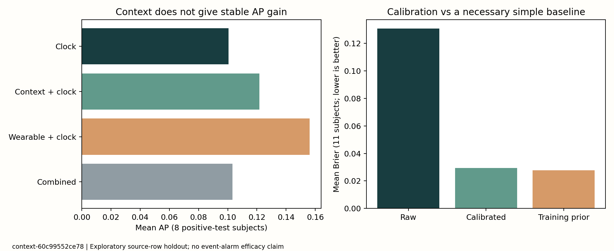

# 情境信息与个体分数校准：本轮验证报告

运行标识：`context-60c99552ce78`；协议 `configs/smartwatch_context_v1_1.json`。11名受试者全部保留，8名测试期含正类。工程与评价验收通过，新增情境的主要AP增益未获支持；不替代事件报警目标。

## 同样测试范围下的主要结果

|输入|原始分数AP|AUC|点敏感度|点特异度|
|---|---:|---:|---:|---:|
|纯时间|0.1006|0.5198|17.4%|91.3%|
|情境+时间|0.1217|0.6709|14.5%|91.3%|
|穿戴+时间|0.1561|0.6013|24.4%|92.5%|
|穿戴+情境+时间|0.1032|0.6035|41.5%|88.8%|

主要配对对照为“穿戴+时间”到“穿戴+情境+时间”：AP差值 **-0.0529**，按人2,000次bootstrap的探索性95%区间 **[-0.1151, 0.0104]**。敏感度增加并没有建立无代价的改进，平均特异度下降；两项必须同时解释。

本轮边界每侧删除150行，和上轮120行范围不同，**不能拿本轮0.1561与上轮0.1887直接推断算法退步或收益**。上轮正向AP证据保留；本轮只做相同测试行之间的配对比较，已独立核对。



## 校准为什么没有自动变成检测能力提升

穿戴+时间分数的平均Brier：原始 **0.1306**、验证期sigmoid/常数退路校准后 **0.0295**、训练期正类比例的固定概率基线 **0.0278**。校准明显修正了原始加权分类器的过高分数，但未稳定超过简单概率基线；不能单凭Brier下降宣称能可靠报警。

校准只读取验证期标签，不改模型训练或用测试标签拟合。正斜率sigmoid保持非递减次序；截断极端logit可能产生并列分数。非正斜率退回验证期正类比例，不把坏模型反向排列以制造排序收益。穿戴+时间组7人使用sigmoid，4人常数退路，其中2人验证期单类。相关测试期漏识别、NA和分母均保留。

## 数据和信息边界

- 输入只有腕部汇总、时间以及新增的 `IOB`、`time_since_lastmeal_ord`。CGM及源低血糖标签从不进入输入列。
- 作者`IOB`是每次既往注射在其后4小时按1/0.75/0.5/0.25构造的无量纲活动指数；它不是体内剩余剂量，不能用于给药建议。
- 用餐字段有缺失：受试者13整列缺失、注射活动指数全为0。保留该人并显式记录；源零值不证明实际没有注射或进食。
- 本轮需要手工/源日记情境，不能称为纯传感器升级，也没有新增硬件收益结论。
- 源CSV仍缺完整时间戳。源行顺序留出只是探索性替代；150行边界是在名义分钟行假设下覆盖240分钟情境与15分钟标签确认的保守设置，不证明真实时间完整。
- 初始120行边界版本已隔离：运行在尝试中断前已完成，但未纳入效果分析、未用于选择高分。登记于 `docs/acceptance/CONTEXT_V1_ABORTED.json`，本地输出保留。

## 验收证据与复现

132组（11人×4组输入×原始/校准/概率基线）独立复算通过，最大数值差异为 `1.11e-16`，校准映射复算差异 `0`。核对了源标签、同测试行、特征白名单、模型候选选择、验证阈值、校准训练来源和行边界。

```powershell
python scripts/run_contextual.py --config smartwatch_context_v1_1.json
python scripts/verify_contextual.py
python scripts/export_improvement.py
python scripts/export_context_report.py
python -m pytest -q
```

运行器对已存在实验目录停止，避免静默覆盖；同机已完成本轮，不要重复运行以挑选成绩。原始数据与逐点预测继续被Git忽略。完整汇总见 `docs/acceptance/CONTEXT_V1_1.json`。

## 下一步

这轮没有支持继续无界叠加日记特征或学习器。下一优先级是PhysioCGM心搏形态与伪影质量、源时钟证据，及更可信的原始带时间数据。后续需要在新协议下判断改善来自真实生理信息、个体适应还是生活时间规律；既有测试已查看，所有再利用仍标探索性。
