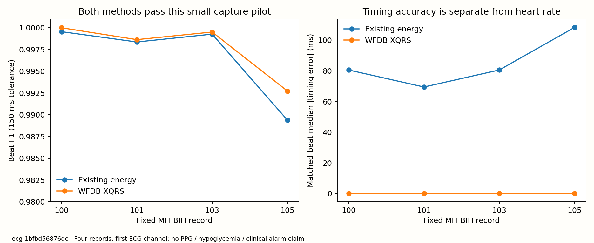

# ECG 心搏捕获：四记录先导验收

运行标识 `ecg-1bfbd56876dc`。**两种方法都通过本次捕获门槛；这不是低血糖检测通过。**

## 问题与冻结范围

检验现有能量峰值方法能否准确捕获带专家标注的心搏，并与默认XQRS对照。固定MIT-BIH v1.0.0的100、101、103、105记录、第一通道、全部完整五分钟非重叠窗口；没有按成绩选通道/片段或调参数。

共24个窗口、48组方法结果。每窗两端各2秒不评分，共118.4分钟可评分时间；每条末尾2,000样本（5.56秒）不足完整窗口未评分。裁边对专家与算法相同，未以质量或节律删除窗口。参考保留配置中的全部心搏类别，排除节律/伪影标记；没有只保留正常N心搏。

一对一匹配容差150ms，先匹配最早可行心搏；独立评分用最大二部匹配核对数量，再用二分搜索重构配对核对时序误差。门槛在运行前固定：每条记录敏感度及PPV均≥95%，24窗心率均可计算，平均心率绝对误差≤3bpm。此门槛为项目内部先导要求，不是临床标准。

## 结果与决策

记录等权平均F1：现有方法 **99.6641%**，XQRS **99.7719%**，增加约 **0.108个百分点**。平均心率误差分别 **0.0347** 与 **0.0353 bpm**，没有支持心率提取误差获得实质改善。

|记录|方法|心搏敏感度|心搏PPV|心搏F1|窗心率MAE/bpm|已匹配心搏绝对时序误差中位数/ms|
|---|---|---:|---:|---:|---:|---:|
|100|现有能量法|99.96%|99.96%|99.96%|0.000|80.6|
|100|XQRS|100.00%|100.00%|100.00%|0.045|0.0|
|101|现有能量法|99.95%|99.73%|99.84%|0.074|69.4|
|101|XQRS|99.95%|99.78%|99.86%|0.032|0.0|
|103|现有能量法|99.90%|99.95%|99.93%|0.000|80.6|
|103|XQRS|99.90%|100.00%|99.95%|0.000|0.0|
|105|现有能量法|99.45%|98.43%|98.94%|0.064|108.3|
|105|XQRS|99.84%|98.71%|99.27%|0.064|0.0|



能量包络峰并非精确R峰位置，因此同时公布时序误差。更小的已匹配心搏定位误差不能直接推断HRV更准确：RR/RMSSD、异常心搏过滤和漏搏后的连续性尚需单独验收。心率取60/中位RR，专家与候选均保留0.3–2秒RR且至少5个间隔；这个稳健定义可能掩盖零散错搏，不能替代心搏敏感度和PPV。

**本次不替换PhysioCGM原始特征。** 四条方便抽样的参考ECG成绩较高，只支持捕获流程在这批记录上可用。不能把低血糖失败简单归咎于粗峰值方法，也不能据此认定目标胸带、运动伪影或腕部PPG没有问题。下一步先扩展更完整ECG/噪声验证，再以冻结方案在PhysioCGM比较捕获一致性、覆盖与质量；没有专家标注的目标波形只能做一致性审计，不能自称准确率。

## 时间、许可与复现边界

- 算法只接收当前五分钟窗口，不读取窗结束后的样本。XQRS的窗内处理包含双向滤波/学习，**不是逐心搏零延迟实时算法**。该先导的输出时刻是窗口末端。
- [MIT-BIH官方数据说明](https://physionet.org/content/mitdb/1.0.0/)：Moody与Mark，2005，DOI[10.13026/C2F305](https://doi.org/10.13026/C2F305)，ODC Attribution v1.0；另引原始研究Moody & Mark, 2001, DOI[10.1109/51.932724](https://doi.org/10.1109/51.932724)。本次从官方文档公开S3镜像下载，12文件均以主站SHA256表校验，来源哈希见验收记录。
- [WFDB Python](https://github.com/MIT-LCP/wfdb-python)，MIT许可，固定4.3.1；[XQRS说明](https://wfdb.readthedocs.io/en/latest/processing.html#wfdb.processing.xqrs_detect)。只调用安装包，未复制其实现。四记录没有足够证据作人群泛化或临床推断。
- 没有血糖标签、糖尿病人群有效性、PPG验证、事件报警、传感器替代或疾病恶化预警结论。原始记录和逐搏匹配留在Git忽略目录；发布配置、代码、来源校验与汇总结果。

```powershell
python -m pip install -e ".[signals,reports]"
python scripts/download_ecg_pilot.py
python scripts/run_ecg_pilot.py
python scripts/verify_ecg_pilot.py
python scripts/export_ecg_pilot.py
```

本机WFDB在`outputs/signal_runtime`隔离环境；运行命令使用该环境Python。运行器拒绝覆盖已存在实验，完成记录为`outputs/ecg_capture_pilot_v1/completed.json`；无需重新评分。独立复算记录见[ECG_CAPTURE_PILOT1.json](acceptance/ECG_CAPTURE_PILOT1.json)。
