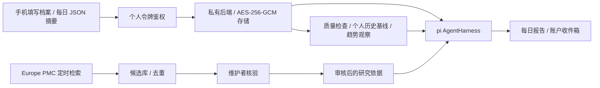

# 个人健康 Agent：实现、接入与边界

这是现有 T1D Wearable Lab 上新增的可运行健康研究助理。公开入口为 [GitHub Pages / #agent](https://PYxuejiang.github.io/t1d-wearable-lab/#agent)。原有手表展示、研究证据及 V1–V5 失败结果保留；本模块没有改变原模型、疾病终点或验收阈值。

## 功能与数据流



- 手机网页可填写成人年龄段、既往确诊情况、用药背景、个人目标、报告时区与时间。不要求姓名或联系方式。档案由用户明确确认，Agent 不能自行改写。
- 导入每日摘要：日期、来源、化名设备 `deviceId`、佩戴小时、信号质量、静息心率、HRV、睡眠小时、步数及主动报告的症状。缺失值为 `null`，不可用零代替。不同设备独立建立基线，设备 ID 不应使用硬件序列号等可识别信息。统一接口不是蓝牙、HealthKit 或 Health Connect 的已完成原生集成；手机适配器需将厂商数据转换后提交。
- 用当日之前最多 28 天的同来源、佩戴至少 12 小时、质量分至少 0.7 的日记录计算个人中位基线；每个指标至少 7 个非缺失历史日。合成数据不参与真实导入数据的基线。质量分需由设备适配器定义与验证，本项目不宣称已验证各厂商质量分的可比性。
- 目前观察规则：静息心率较基线增加至少 10 bpm、HRV 下降至少 25%、睡眠减少至少 1.5 小时。它们是可解释的原型工程规则，**不是医学诊断阈值、校准后的疾病概率或经过验证的风险预测**。低质量时明确弃权；症状提示优先，不等待模型。
- 真实接入使用 `@earendil-works/pi-agent-core` 的 **AgentHarness**、Session 和只读工具。`read_profile` 读取当前用户最小档案；`analyze_day` 读取确定性分析；`retrieve_evidence` 读取审核来源。模型只能排序已存在观察 ID，缺工具、非法 ID、超时或错误都回退规则报告，不能输出新诊断或用药内容。最多 5 次模型请求、总等待 30 秒、无自动重试。不会运行模型生成的代码或 shell。
- worker 按用户当地时间，每天在设定时间后生成前一日的完整日报，同日已生成则跳过；尚无该日数据时等待导入，不伪造报告。报告进入鉴权收件箱，网页打开时每分钟检查；可手动开启本页系统通知，通知不含健康详情。当前**没有邮件、短信、浏览器关闭后的 Web Push 或真实医疗报警**。

## 可学习性的具体含义

1. **档案记忆**：持久化用户确认的背景与目标。用户可改、可删；不把对话推断自动当作既往诊断。
2. **个体适应**：每天新记录进入历史窗口，随后更新统计基线。报告保留输入指纹、使用日期与依据，防止把今天或未来数据混入过去。
3. **知识更新**：私有 worker 每天检索 Europe PMC 最近 30 天相关研究，每轮最多 25 条，按来源和 ID 去重，保留最近成功检索时间；失败保留旧库并在至少一小时后重试。它是有上限的近期检索，不是完整系统综述，漏检可能存在。
4. **审核升级**：新文献全部为 `pending`，不能作为报告依据。维护者核验设计、人群、相关性、撤稿情况和局限并写审核备注后，才进入 `reviewed`。不自动微调模型、不自动改变医学或工程规则。需要疾病预测能力时，先建立适用人群、终点、校准与前瞻验证协议。

## 本地启动

需要 Node >= 22.19。代码采用可擦除 TypeScript，由 Node strip-only 模式运行。SQLite 是 Node 22 的实验性内置功能，运行时会有对应提示。依赖精确固定在根锁文件，不运行安装生命周期脚本。

```powershell
npm ci --ignore-scripts
cd showcase
npm ci --ignore-scripts
cd ..
npm run check
```

从 `.env.example` 复制成忽略的 `.env`。在本机分别生成两份独立秘密，填入 `HEALTH_DATA_KEY` 与 `HEALTH_TOKEN_SECRET`，每个是 32 字节随机值的十六进制表示：

```powershell
node -e "console.log(require('node:crypto').randomBytes(32).toString('hex'))"
```

不要把生成结果贴到 GitHub、网页、报告或截图中。根目录运行：

```powershell
node --env-file=.env --experimental-strip-types agent/cli.ts token my-user
node --env-file=.env --experimental-strip-types agent/server.ts
```

第一条仅在本机终端显示该应用个人令牌，用于鉴权自己的数据，不是模型 API key。使用另一个常驻终端启动 worker，并在 `showcase` 启动前端：

```powershell
node --env-file=.env --experimental-strip-types agent/worker.ts
cd showcase
npm run dev
```

在网页「连接私有服务」填 `http://127.0.0.1:8787` 和本应用令牌，然后保存档案、导入页面提供的合成模板验证闭环。真实设备导入须标记 `source: "phone-import"`，不得将合成值冒充测量。

服务默认只监听本机。`HEALTH_ALLOWED_ORIGIN` 必须是实际前端来源（例如本机 `http://127.0.0.1:5173` 或 Pages 的 `https://pyxuejiang.github.io`，不带仓库路径）。从 HTTPS Pages 连接本机 HTTP 服务可能需要浏览器本地网络许可；正式手机访问需要你控制的 HTTPS 后端、反向代理、进程托管与备份策略。GitHub Pages 不能运行这个后端或定时 worker；本次不会把私人数据上传 GitHub，也不会假称公开页面已是医疗云服务。

如需模型参与，在**私有后端** `.env` 设置 `HEALTH_LLM_ENABLED=true`、`DEEPSEEK_API_KEY` 和 `HEALTH_MODEL=deepseek-flash`，同时用户在档案中另行同意将健康背景与统计摘要发送给 DeepSeek。默认不开启。现有其他项目里的 key 不复制进本仓库，也不使用 `VITE_` 变量。模型故障不影响规则日报；状态明确显示 unavailable。

## 文献维护与 API

```powershell
node --env-file=.env --experimental-strip-types agent/cli.ts refresh
node --env-file=.env --experimental-strip-types agent/cli.ts review MED:123456 "人工核验后的研究类型、适用人群、撤稿状态、局限及允许用途，至少20字符"
node --env-file=.env --experimental-strip-types agent/worker.ts --once
```

示例文献 ID 只是命令格式占位，需替换为本地实际候选；审核命令不发送临床建议。检索是固定的疾病/睡眠/可穿戴主题，不把个人档案发送给文献服务。

所有 API 都要求 `Authorization: Bearer <本应用个人令牌>`，没有可指定他人 ID 的浏览器参数：

| 接口 | 用途 |
|---|---|
| `GET/PUT /api/profile` | 读取或更新当前用户档案 |
| `GET/PUT /api/days` | 查询或批量导入最多 90 日的摘要，单次最多 250 KB |
| `POST /api/reports/generate` | `{ "date": "YYYY-MM-DD" }`；每用户每分钟最多一次 |
| `GET /api/reports` | 最近 30 份日报 |
| `POST /api/reports/read` | 按日期标为已读 |
| `GET /api/evidence` | 审核/候选记录及上次检索时间 |
| `DELETE /api/account` | 删除当前用户在线档案、摘要及报告 |

数据库默认 `.private/health-agent/health.sqlite`，健康内容以 AES-256-GCM 加密，并将用户、记录类型和 ID 绑定为认证附加数据，防止密文跨用户替换。数据库与其 WAL、SHM、备份都须保持私有；密钥丢失无法恢复，加密不代替服务器访问控制。元数据包含化名和记录日期。删除接口删除在线记录，不承诺清理运维备份；SQLite 页的历史密文可能保留，磁盘擦除与备份过期由运维管理。主密钥变更需迁移，身份令牌主秘密轮换会使既有令牌失效；本原型无单令牌撤销、完整审计、反滥用网关或医院级身份系统，不应直接向公众开放注册。

## 验证与参考

2026-10-23 增加 [Transformer/LoRA 离线研究模块](TRANSFORMER_LORA.zh-CN.md)。`knowledge` 入口加入带局限的 SPAID/STING 公开机制摘要，原 Harness 三工具与日报排序不变。`research-snapshot` 仅提供显式训练授权后的纯函数桥接，首版背景只编码年龄段，未开放数据库训练导出接口；`shareWithModel` 不代表同意训练。研究模型当前不进入线上报告，不输出新的疾病概率。

`npm run check` 检查后端类型、离线 Node 测试、真实 harness + faux provider 工具调用、前端类型、生产静态产物与疑似凭据扫描。测试不使用真实用户健康数据、真实 provider 或付费 token。公开产物仅保留原有聚合证据与新增合成演示代码，发布工作流继续禁止患者数据和凭据。

- [FDA 官方血糖设备提醒](https://www.fda.gov/medical-devices/safety-communications/do-not-use-smartwatches-or-smart-rings-measure-blood-glucose-levels-fda-safety-communication)：独立手表估算血糖不可作为本项目能力。
- [PHIA 原始研究](https://arxiv.org/abs/2406.06464)：工具分析和检索的系统设计参考，不是本产品临床效能证据。
- [PhysioLLM 原始研究](https://arxiv.org/abs/2406.19283)：将生理数据、统计分析和个人情境结合的方法参考。
- [Europe PMC 官方 REST 文档](https://europepmc.org/RestfulWebService)：有界检索与元数据来源。

新增公开研究摘要经research-evidence/knowledge进入原retrieve_evidence，包含PPG工程验收、真实时序微调对照及独立抗体混杂诊断。个人模型推理、诊断和自动再训练仍未启用，原三工具和回退保持。详见[实施记录](MULTIMODAL_BRANCHES.zh-CN.md)。
