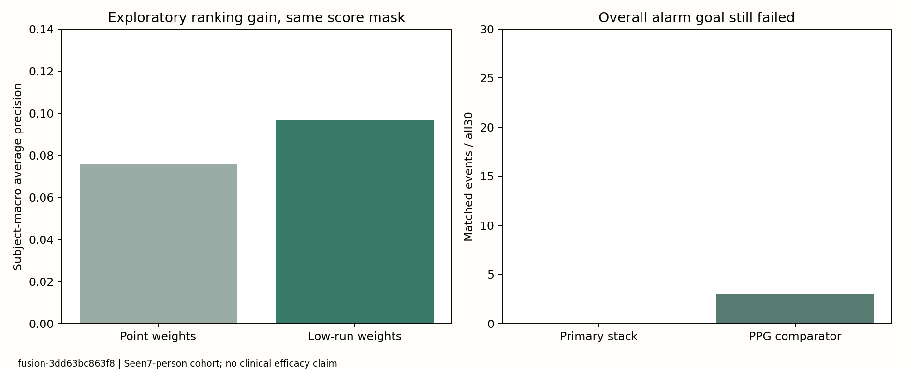

# 第四轮：后期融合与低值片段权重

日期2026-10-18，运行`fusion-3dd63bc863f8`。392组独立复算通过，**主要事件检测仍失败**。方法与来源详见[METHOD_CHANGE_V4](METHOD_CHANGE_V4.zh-CN.md)，所有对照与次预算均保留。

## 可复核的排序改善

同一批测试点、同一联合可用掩码，后期融合的点权重方案AP **0.0755**，片段权重方案 **0.0969**。按7人配对AP差 **+0.0213**，2,000次按人bootstrap的未校正探索性95%区间 **[0.0041, 0.0437]**。这是已看过队列的整个训练方案比较，基础模型选择也随权重变化，不是对片段权重机制的独立因果证明。

AP改善没有转成事件检测改善：点权重方案命中1/30、误报1.014；预设片段权重主方案命中 **0/30**、误报 **0.127/参考人日**。相对同权重早期融合及缺失+时间控制，AP差区间仍跨零。没有宣布可靠生理增益或临床可用。



## 全部主预算结果

预算1是验证期约束，不保证测试误报≤1。事件宏召回按人等权，与命中数/30不同；所有30次参考事件均保留。

|路线 / 权重|宏AP|命中/事件|宏事件召回|实际误报/参考人日|宏时间覆盖|
|---|---:|---:|---:|---:|---:|
|缺失+时间 / 点权重|0.0680|0/30|0.0%|0.042|82.8%|
|早期特征融合 / 点权重|0.0877|0/30|0.0%|0.296|82.8%|
|ECG专家 / 点权重|0.0807|0/30|0.0%|1.014|75.1%|
|PPG专家 / 点权重|0.0992|3/30|6.9%|0.718|72.8%|
|EDA专家 / 点权重|0.0948|2/30|7.6%|0.971|72.8%|
|专家平均 / 点权重|0.0855|2/30|4.9%|1.014|82.8%|
|后期逻辑融合 / 点权重|0.0755|1/30|2.9%|1.014|82.8%|
|缺失+时间 / 片段权重|0.0594|0/30|0.0%|0.127|82.8%|
|早期特征融合 / 片段权重|0.0724|0/30|0.0%|0.000|82.8%|
|ECG专家 / 片段权重|0.0812|0/30|0.0%|1.352|75.1%|
|PPG专家 / 片段权重|0.0922|0/30|0.0%|0.000|72.8%|
|EDA专家 / 片段权重|0.0644|0/30|0.0%|1.352|72.8%|
|专家平均 / 片段权重|0.0597|0/30|0.0%|0.802|82.8%|
|后期逻辑融合 / 片段权重|0.0969|0/30|0.0%|0.127|82.8%|

单模态有效点可能不同，不应把表内所有AP直接相减。主要配对比较使用相同联合可用掩码；共同腕部视图与全部逐人汇总在验收JSON。

## PPG专用模型：一个有限的后续线索

预先列出的PPG/点权重对照命中 **3/30**（总体10.0%，宏召回6.94%），误报 **0.718/参考人日**，覆盖 **72.80%**。验证期选中逻辑回归C=0.1和连续两点确认。命中只来自c2s02的1次、c2s05的2次；其他5人没有命中。它未达到80%召回/80%覆盖，且不是本轮预设主方案。

看完结果后，对冻结分数补做了PPG/EDA与同权重时间+缺失控制的共同腕部掩码配对分析，明确记为事后描述，未重训练或修改阈值。PPG点权重AP差为+0.0255，区间[-0.0121, 0.0797]；不作为确认性成功。旧v2静态主预算1/30、本轮PPG3/30也不能单靠两次增加就证明泛化改善。

## 主方案漏检分解

3次无输入；26次有输入但未达阈值；1次有高分但事件期没有报警。没有修改时钟、事件终点或冷却来重新认领漏检。胸带后备的82.84%覆盖属于上一轮已有策略，本轮未再声称覆盖增加。

## 次要预算2：全部报告

|路线 / 权重|宏AP|命中/事件|宏事件召回|实际误报/参考人日|宏时间覆盖|
|---|---:|---:|---:|---:|---:|
|缺失+时间 / 点权重|0.0680|1/30|2.9%|1.816|82.8%|
|早期特征融合 / 点权重|0.0788|1/30|2.9%|1.605|82.8%|
|ECG专家 / 点权重|0.0852|1/30|2.9%|1.689|75.1%|
|PPG专家 / 点权重|0.0992|3/30|6.9%|0.718|72.8%|
|EDA专家 / 点权重|0.0935|1/30|2.9%|1.647|72.8%|
|专家平均 / 点权重|0.0855|2/30|4.9%|1.605|82.8%|
|后期逻辑融合 / 点权重|0.0755|1/30|2.9%|1.014|82.8%|
|缺失+时间 / 片段权重|0.0594|0/30|0.0%|0.127|82.8%|
|早期特征融合 / 片段权重|0.0724|2/30|4.9%|1.943|82.8%|
|ECG专家 / 片段权重|0.0812|0/30|0.0%|1.352|75.1%|
|PPG专家 / 片段权重|0.1050|3/30|6.9%|0.929|72.8%|
|EDA专家 / 片段权重|0.0644|0/30|0.0%|1.352|72.8%|
|专家平均 / 片段权重|0.0597|0/30|0.0%|0.802|82.8%|
|后期逻辑融合 / 片段权重|0.0969|2/30|7.6%|1.563|82.8%|

## 来源、验收与复现边界

- 原始34,218个特征参考标签全部一致。10人各1个固定作者加工片段的CGM索引、时间和值与原始记录一致；三个可匹配腕部片段均对应UTC−5。其余7个首片段没有可用非恒定腕部序列，不能推断偏移。原始CGM/胸带物理时钟仍缺独立校准。来源验收见[SOURCE_TIME1](acceptance/SOURCE_TIME1.json)。
- 30个基础候选内部AP和选择排序、28个选中验证工作点、训练片段/类别/按人权重及全部392组测试独立检查；最大指标差1.11e-16。
- 独立从内层未参与基础拟合的分数重建融合输入并重拟合融合器；验证/测试分数最大差2.39e-15。没有把训练内预测用于融合训练。基础选参与融合拟合共用内层留出，重拟合专家也可能造成分数分布变化，局限保留。
- 仍为7人早期个体数据参与训练、未来时间留出，不是新人LOSO或外部验证。所有原始数据、加工片段与逐点预测仅本地保存，公开汇总与自写代码。

本次新增训练全部完成，不能反复调这一测试集。下一优先级是验证PPG/RR与原始短窗形态是否提供新增信息，并把表现差的5人保留；先冻结质量与特征协议，再做模型比较。全项目事件验收仍未通过。

```powershell
python scripts/run_late_fusion.py
python scripts/verify_late_fusion.py
python scripts/export_late_fusion.py
```

已有输出目录时训练程序拒绝覆盖；复核既有结果只运行验证和导出。完整验收：[V4_LATE_FUSION1.json](acceptance/V4_LATE_FUSION1.json)。
