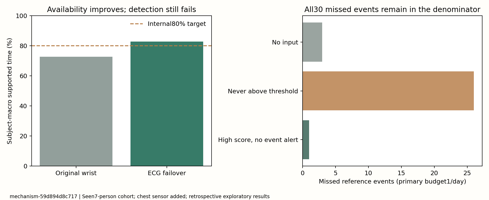

# 指标改进第三轮：先修复可用性，检测效果仍未达标

运行标识`mechanism-59d894d8c717`；固定协议`configs/mechanism_v3_1.json`，方法解释见[METHOD_CHANGE_V3](METHOD_CHANGE_V3.zh-CN.md)。**336组独立复算通过；预设主要低血糖检测目标失败。**

## 本轮真正改善了什么

旧腕部完整输入的宏时间覆盖 **72.80%**，腕部或ECG后备策略 **82.84%**，按人配对增加 **10.04个百分点**，探索性95%区间 **[2.54, 21.46]个百分点**。全30次测试事件中，至少一次有输入的事件由25次增加为27次；这些事件的总分母始终不变。

这是可用性策略改善，来自**增加胸带ECG后备**。不是纯手表升级、真实设备在线率、临床有效性或单独传感器精度验证。完整流程训练机会也变化，不能只将成绩差归因于新增某一特征；共同腕部视图与缺失模式控制另列验收JSON。



## 主预算：没有藏掉失败

下表所有新版均按预先固定的共同验证参数选择、测试预算标签1展示；**预算是验证期约束，测试实际误报必须另看**。30次事件全部保留，宏召回按7人等权，不等于命中总数/30。

|路线与验证选参|命中/总事件|宏事件召回|测试误报/参考人日|宏时间覆盖|
|---|---:|---:|---:|---:|
|旧v2静态：个人验证、预算1|1/30|1.8%|0.296|72.8%|
|纯时间：共同验证、预算1|1/30|2.9%|0.845|72.8%|
|个人精简特征：共同验证、预算1|0/30|0.0%|0.802|72.8%|
|个人活动残差：共同验证、预算1|1/30|2.9%|1.014|72.8%|
|共享活动残差：共同验证、预算1|0/30|0.0%|0.084|72.8%|
|共享模型+ECG后备：共同验证、预算1|0/30|0.0%|0.042|82.8%|
|仅缺失模式+时间：共同验证、预算1|0/30|0.0%|0.296|82.8%|

预设主方案`pooled_fallback/pooled_validation/b1/end_to_end`的阈值为 **0.8326**，策略 **legacy_edge**；验证期宏召回14.3%，测试期 **0/30**。不能看到更好的副方案后替换主方案。

训练内部留出选出的主方案模型参数为`{"model": "logistic", "C": 1, "class_weight": "balanced"}`。这次选择了逻辑回归C=1、均衡类别权重；确认/平滑策略没有在主预算验证准则下胜出，因此保留原上升沿，而不是强制新策略获胜。

## 漏检到底发生在哪

- 3次：事件内完全没有可用输入。
- 26次：事件内有输入，但分数从未达到已锁定阈值。
- 1次：事件内有高于阈值的分数，但当前报警状态/冷却没有在事件内发出报警。

同样可用机会、假设每个可用点的真实标签可完美识别，再经过本次固定报警策略，只能命中23/30次；这是**反事实诊断**，不是真实模型指标，也不证明任何学习算法能达到。它说明“有一次输入”的上限仍忽略了报警策略对相邻事件的限制。

主方案唯一未匹配报警发生在记录事件前30分钟内（1次）。这个时序分解只作描述，**该报警仍保留为当前检测任务的误报**；没有移动CGM时钟或将它重命名为有效预警。来源时钟与参考延迟尚不能支持这种结论。其他预设路线的重复/提前/滞后报警分类与验证/测试正负分数分布在验收JSON中完整保留。

主要瓶颈不是仅由报警状态机造成：26次漏检连阈值都未越过。下一步必须核对分数与参考标签的关系、源对齐和信号信息量，而不是只延长冷却来压低误报。

## 次要预算2：有命中，但不能替代主目标

|预设次要路线|命中/总事件|宏事件召回|测试误报/参考人日|宏时间覆盖|
|---|---:|---:|---:|---:|
|纯时间：共同验证、预算2|2/30|4.6%|1.478|72.8%|
|个人精简特征：共同验证、预算2|2/30|5.7%|0.929|72.8%|
|个人活动残差：共同验证、预算2|2/30|4.9%|2.238|72.8%|
|共享活动残差：共同验证、预算2|0/30|0.0%|0.084|72.8%|
|共享模型+ECG后备：共同验证、预算2|2/30|17.1%|1.858|82.8%|
|仅缺失模式+时间：共同验证、预算2|0/30|0.0%|0.296|82.8%|

后备方案在此工作点命中2/30次，宏召回17.1%，测试误报1.858次/参考人日。宏召回由各人事件数决定，不能把17.1%写成总体事件命中比例；2/30为6.7%。它未达到主要1次误报预算或80%召回要求，也没有建立稳定传感器检测收益。

## 个人与共同验证：全部固定对照

|路线 / 报警选参来源（预算1）|命中/总事件|宏事件召回|测试误报/参考人日|宏时间覆盖|
|---|---:|---:|---:|---:|
|纯时间 / 个人验证|0/30|0.0%|0.211|72.8%|
|纯时间 / 共同验证|1/30|2.9%|0.845|72.8%|
|个人精简特征 / 个人验证|0/30|0.0%|0.084|72.8%|
|个人精简特征 / 共同验证|0/30|0.0%|0.802|72.8%|
|个人活动残差 / 个人验证|0/30|0.0%|0.084|72.8%|
|个人活动残差 / 共同验证|1/30|2.9%|1.014|72.8%|
|共享活动残差 / 个人验证|0/30|0.0%|0.591|72.8%|
|共享活动残差 / 共同验证|0/30|0.0%|0.084|72.8%|
|共享模型+ECG后备 / 个人验证|0/30|0.0%|0.000|82.8%|
|共享模型+ECG后备 / 共同验证|0/30|0.0%|0.042|82.8%|
|仅缺失模式+时间 / 个人验证|2/30|3.6%|0.549|82.8%|
|仅缺失模式+时间 / 共同验证|0/30|0.0%|0.296|82.8%|

共同模型会使用这7人的早期训练期与既往CGM标签；共同报警参数使用其较早验证期。不是无标签个体校准，也不是新人的LOSO。只用缺失模式+时间的路线也可能命中事件，因此不能将后备组的任何命中都解释为ECG生理信息。

## 方法、参数和验收

冻结六条路线、每条10种超参数，嵌套训练时间留出选择模型；240条内部候选记录全部保留。外层验证选择阈值/4种报警策略，个人/共同选参分别保留，1/2次预算分开，完整流程/共同腕部两个视图形成336组测试结果。确认/EMA/提醒策略在验证期无优势时仍可能选回原上升沿，不强制新方法获胜。

独立核对来源标签、输入时间、外层与内部边界、内部AP及全部候选选择排序、特征白名单、输入机会掩码、选中验证策略63个不同配置、全部测试的事件/报警/误报/延迟与时间覆盖。最大数值差为1.11e-16。所有路线完整结果在[V3_MECHANISM1.json](acceptance/V3_MECHANISM1.json)，未发布患者波形或逐点预测。

AP/AUC只在可评分参考点上评价，不同可用掩码不能相减当作传感器增益。后备对腕部的AP配对差只在共同腕部视图解释；后备与缺失模式控制可在相同联合输入机会比较。覆盖和全部事件召回始终报告完整分母。

本轮修复了覆盖不足的一项限制，但还保留7人、30事件、曾见队列、稀少/单类内部留出、源时钟未证实等限制。既有ECG四记录捕获通过也不能证明目标波形、HRV或血糖标注正确。

```powershell
python scripts/run_mechanism.py
python scripts/verify_mechanism.py
python scripts/export_mechanism.py
python scripts/export_improvement.py
python -m pytest -q
```

本机实验已经完成；运行器拒绝覆盖`outputs/mechanism_v3_1`。不要重复训练以挑测试成绩。下一轮应先核对原始加工对齐与既有加工版本的配对时间证据，再验证更可靠RR/形态特征；不得按识别高分选时钟偏移。
