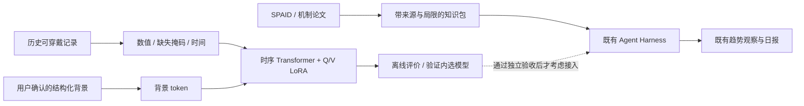

# Transformer、LoRA 与机制知识：实施及验收

日期：2026-10-23。按用户新指令扩展研究分支；保留 Agent Harness，排除原质谱项目的数据、特征和权重。原 V1–V5 的结果、事件分母和失败记录不变。

## 当前交付与适用范围

现已实现可运行的时序 Transformer、Q/V LoRA、用户背景输入、训练/验证分组检查、检查点保存恢复、真实队列的离线训练入口，以及 Harness 机制知识检索扩展。当前通过的是合成数据工程验收；尚未运行真实队列的 Transformer 疾病效果对照，也没有配对蛋白训练。已有日报不调用未经验证的 Transformer 分数。

| 部分 | 已实现 | 当前边界 |
|---|---|---|
| 可穿戴时序 | 数值＋缺失掩码＋经过时间，Transformer 编码 | 不把缺失补零当作真实测量；整段无信号拒绝计算 |
| 用户背景 | 独立 context token 与掩码；Harness 离线摘要桥接 | 首版只将年龄段转为三个明确字段；用药、疾病、目标自由文本仍由 Harness 使用，未强行编码 |
| LoRA | 两层注意力的 Q/V 低秩增量，另训练背景投影和分类头 | 原创小模型，非复用旧质谱模型；不能称为外部预训练基础模型 |
| 蛋白机制 | SPAID 证据层级与 STING 文献摘要，通过现有 retrieve_evidence 工具读取 | 知识不是患者蛋白测量；当前没有蛋白数值 token 或蛋白与时序联合训练 |
| Agent Harness | 原三工具、观察排序、授权、加密、日报回退保持 | 没有把微调变成在线自我训练或诊断服务 |
| QLoRA | 记录后续准入条件 | 未实现/未验收 4-bit 底座，不将普通 CPU LoRA 称为 QLoRA |



模型使用历史窗口内双向注意力；只输出窗口末端任务结果，不声称窗口内部逐点在线因果推理。窗口中的所有输入及背景必须在预测截止时已可获得。原始 PPG 不能不经分窗/降采样审计就直接塞进本次日级摘要模型；日级桥接和 PPG 事件检测是两种输入协议，需要各自训练权重。

## 已完成的工程验证

独立 CPU 环境 PyTorch 2.5.1；固定种子 2301。合成六通道序列先进行 60 步掩码重建预训练，再进行 80 步 LoRA 微调，由合成验证集选择步骤。底座不是随机初始化后直接冻结；也不是疾病训练完成的模型。

- 总参数 21,159；可训练 1,281（约 6.1%，含背景投影和分类头，不能全部称为 LoRA 参数）。
- 零初始化适配器前后输出最大差 0；冻结参数逐值不变；LoRA B 矩阵得到更新。
- 保存/恢复后输出最大差 0；检查点绑定底座 SHA-256，拒绝错配与未授权权重键。
- 合成重建训练损失 0.7980 → 0.1333，仅用于训练链路检查，不是患者效果或泛化证据。
- 已检查缺失值、无信号拒绝、未来输入、重复日期、不同设备、训练/验证人员重叠、验证数据不参与归一化拟合、模型共享同意不等于训练同意。
- 另用合成 NPZ 全流程运行通用预训练及微调入口，每阶段固定 40 个 epoch；测试集不打开，全部验证损失留档。

首次检查出现环境临时目录权限问题和沙箱本机 HTTP 限制，改用工作区测试临时目录及获批本机测试后复核；新增两条机制文献导致原文献数量断言需更新为“原集合＋新增一条”的语义。保留这些问题记录，不把未执行测试计为通过。

公开汇总见 [LORA_ENGINEERING1.json](acceptance/LORA_ENGINEERING1.json)。权重、训练数组、逐条输出均留在忽略目录，不上传公开仓库。

## 数据来源核查

截至本次检查，**未核验到可以直接拿来训练“同一 T1D 人群、同一时间轴、蛋白/抗体＋可穿戴＋低血糖结局”的公开配对数据**。这不是说此类数据绝对不存在。

| 来源 | 可利用内容 | 访问与配对结论 |
|---|---|---|
| [PhysioCGM](https://pmc.ncbi.nlm.nih.gov/articles/PMC12630648/) | 已有多模态生理信号与 CGM 参考 | 现项目有数据；未报告与本队列配对的蛋白/抗体面板 |
| [BrisT1D](https://data.bris.ac.uk/data/dataset/33z5jc8fa6tob21ptrugzqog08) | 血糖、治疗/饮食及可穿戴记录 | 可用于另行冻结的背景增益实验；不代表有蛋白数据，也不允许把 CGM 输入偷渡进 PPG-only 检测 |
| [GSE45515](https://www.ncbi.nlm.nih.gov/geo/query/acc.cgi?acc=GSE45515) | T1D 自身抗体蛋白芯片，官方设计 74 例病例/75 例对照、约 750 种蛋白；原始 TXT 下载入口 | 非质谱路线，适合独立抗体研究；未见可穿戴配对。149 个 GEO 样本不能未经身份审计就称为149名独立受试者；a/b 命名、重复和批次待核查 |
| [RA flare 研究](https://www.nature.com/articles/s41598-025-29748-y.pdf) | 可穿戴与症状、CRP 炎症检测 | 是配对研究线索，但数据需向通讯作者合理申请；不是现在免申请可下载的训练集。CRP 不等于全面蛋白组，RA 结局不能替代 T1D 低血糖 |
| [PHD / iPOP 平台论文](https://www.nature.com/articles/s41467-021-26040-1) | 可穿戴、临床与组学整合框架；论文列出公开可穿戴示例压缩包 | 平台具有整合能力不等于公开包包含完整可链接蛋白检测。尚未完成压缩包成员、受试者键与时间轴核验；不列为配对训练集 |

不下载/执行不明许可的第三方训练代码，不联系作者，不将不同数据库里疾病相同的人视为同一个人。GEO 发布可下载与具体复用、患者身份和分析设计的验收分开记录。

## 蛋白知识如何使用

[SPAID 论文](https://link.springer.com/article/10.1007/s44307-026-00117-8)用于解释自身抗原的证据层级；既有 SPAID/PTM-Mamba 分析只作为研究背景，不搬运候选表或把预测位点当阳性标签。[STING 原始研究](https://www.nature.com/articles/ncomms11932)支持特定实验中 C88/C91 棕榈酰化与信号激活的联系；不能推断用户的 STING 修饰状态或当次低血糖病因。

知识包只含公开来源、机制摘要和适用边界。已有审核状态可以覆盖内置条目；报告引用列表与 Harness 收到的证据来自同一 knowledge 入口。现有 Harness 仍只输出合法观察 ID 排序，因此这次并未扩展成自由生成的医学机制诊断问答。

如果将来取得配对蛋白检测，须新增检测时间/可获得时间、单位、批次、样本类型、受试者关联键和缺失模态协议，再冻结新实验。没有检测结果时的蛋白掩码必须缺失，不能按疾病填平均向量、模型猜测值或论文标签。

## 复现和真实数据入口

在隔离环境安装项目与 PyTorch CPU 版；本次环境放在 `outputs/peft-env/`，未修改全局 PyTorch。项目额外依赖为 `.[finetune]`。例如：

```powershell
python -m venv --system-site-packages outputs/peft-env
./outputs/peft-env/Scripts/python.exe -m pip install torch==2.5.1 --index-url https://download.pytorch.org/whl/cpu
./outputs/peft-env/Scripts/python.exe -m pip install -e . pytest
./outputs/peft-env/Scripts/python.exe scripts/smoke_wearable_lora.py
./outputs/peft-env/Scripts/python.exe -m pytest -q --basetemp outputs/pytest-new-run
```

离线 `agent/research-snapshot.ts` 是纯函数，不自动导出数据库。调用者须另有训练授权；当前产品 UI 尚无训练同意按钮。日级背景只编码年龄段，保留断档时间和缺失掩码，拒绝未完成当地日期或未来才填写的背景。输出没有疾病标签，必须由独立标签流程关联；不能拿日报规则生成标签再报告“预测临床结局”。

通用入口：

```powershell
python scripts/train_wearable_lora.py --manifest outputs/study/manifest.json --stage pretrain --output outputs/study/pretrain
# 将输出底座路径和SHA加入同一研究清单，再运行
python scripts/train_wearable_lora.py --manifest outputs/study/manifest.json --stage finetune --output outputs/study/finetune
```

每次使用新输出目录。清单必填：`scope=offline-research-only`、`data_kind=real|synthetic`、`protein_measurements=false`、`training_authorized=true`、`data_authorization`、`protocol_id`、`feature_schema`、`context_encoding`、`label_definition`、`subjects.train/validation/test`、`model`、`train_file`、`validation_file`；微调再填 `base_checkpoint`、`base_sha256`。人员列表必须无交集。授权字段是审计声明，代码无法代替数据许可或真实知情同意。

两个 NPZ 均禁止 pickle；包含 `values[N,T,C]`、布尔 `observed[N,T,C]`、`elapsed[N,T,1]`、`context[N,K]`、布尔 `context_observed[N,K]`、字符串 `subject[N]`、UTC epoch 秒 `cutoff[N]`、`available_at[N,T]`、`context_available_at[N]`；微调含独立参考二元 `label[N]`。背景数值的编码和缩放写入 `context_encoding`，仅使用训练分区估计的参数或预先固定单位换算。首版通用入口要求训练和验证均有两类，遇到单类中止并登记，不能静默排除人员。

当前入口做源队列训练人员内的掩码重建预训练；未支持任意外部基础模型导入。只用训练信号拟合标准化，验证集选择重建或 BCE 最佳 epoch。原始源适配、标签审计、窗口重叠清理仍是前置步骤，不能只填几个字段就宣布数据验收。测试数组不加载；当前不输出测试事件命中或阈值，也不生成线上提醒。

## 后续实验的顺序和验收

1. **数据准入**：优先已有 PhysioCGM 的固定人员/时钟/CGM 标签与 PPG 窗口；保持全部原事件分母。人口背景缺失即掩码，不为展示多模态编造年龄。日级 Harness 记录没有低血糖标签，不能直接进行此任务监督训练。
2. **预训练与来源**：先冻结训练/验证/测试人员与时间，训练人员内掩码重建；保存输入清单/哈希、标准化、预训练步数。若使用公开 PPG 权重，再查许可证、编码方式和人员重叠。预训练也不得偷看测试人。
3. **同协议对照**：旧模型、冻结底座只训练头、全量微调、LoRA 信号-only、LoRA＋真正有观测的背景。参数量、运行时间、全部候选、失败和选择规则均报告；目前通用脚本实现 LoRA 分支，其余对照待实现，不伪称已经比较。
4. **疾病增益**：点级 AP/AUC/Brier 与事件召回、前15分钟命中、误报/参考人日、PPV、时间覆盖分开；阈值仅训练/验证选，配对按人区间保留。工程验收通过不改主临床门槛。旧队列已见，任何新结果仍是探索性。
5. **机制解释**：单独评估引用准确、证据层级、拒绝“论文等于患者实测”等行为；不能把解释质量分数混入低血糖 AUC。
6. **产品接入**：只有新增分支完成对应的真实数据、模型和评价验收，再考虑让 Harness 读取带版本/覆盖/局限的离线模型结果。未通过时继续保留现有日报规则及回退。

LoRA 可用于自定义 Transformer 的线性层，参考 [PEFT 自定义模型文档](https://huggingface.co/docs/peft/developer_guides/custom_models)。本项目为便于审计自行实现低秩线性增量，未宣称调用 PEFT 库。[QLoRA 文档](https://huggingface.co/docs/peft/developer_guides/quantization)涉及量化底座与适配器训练；当前无已验收的4-bit后端/适用预训练权重，因此不写成已掌握的项目实测成果。
