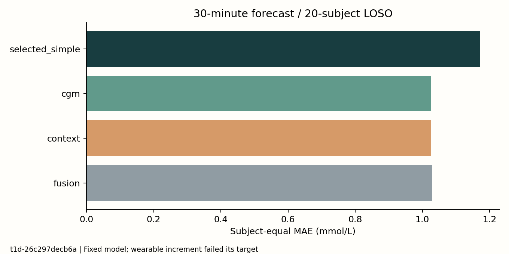
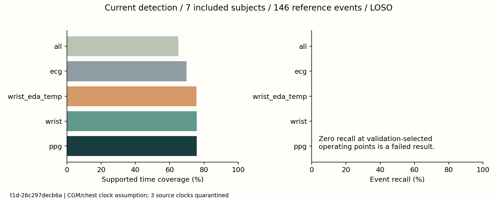
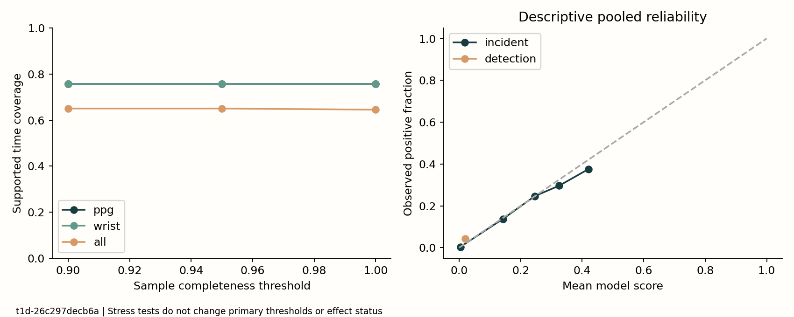

# 两模块验证报告

运行标识：`t1d-26c297decb6a`；协议：`1.2-implementation-1`。阶段判定见 [验收总表](acceptance/STATUS.md)。

本轮完成了公开数据下载、适配、时间审计、固定模型、独立复算、敏感性分析和可视化。**工程/评价流程通过，腕部信息增益与低血糖报警研究目标未通过。** 这些结果支持后续算法研究，不支持把原型作为医疗报警器。

## 数据与纳排

BrisT1D-Open 全部 20 份设备 CSV 已校验，共 2,875,613 源记录、847,956 清理后 CGM 锚点。按通道处理相同/冲突时间戳，418 个冲突组显式排除。名义 CGM 间隔为 5 或 15 分钟。饮食/胰岛素是已记录事件，缺失记录不证明实际没有摄入或用药。记录到达时间不可得，离线因果输入不能证明实时服务延迟。

PhysioCGM 全部 10 份原始 ZIP 已通过官方大小和 MD5 检查，直接流式读取，未展开全部压缩包。7 人的腕部—胸带对齐通过训练期 HR 检查；3 人隔离。排除依据不使用血糖标签或测试成绩。

|源受试者|处理状态|参考锚点|全部通道可用锚点（划分前）|
|---|---|---:|---:|
|c1s01|extracted|5566|2498|
|c1s02|extracted|4839|3116|
|c1s03|extracted|4018|3077|
|c1s04|clock_quarantined|—|—|
|c1s05|extracted|4822|3318|
|c2s01|clock_quarantined|—|—|
|c2s02|extracted|4642|2697|
|c2s03|clock_quarantined|—|—|
|c2s04|extracted|6129|3655|
|c2s05|extracted|4202|3624|

E4 UTC 转为胸带壁钟的候选偏移只在前 60% 的独立 HR 信号上判定。CGM 与胸带朴素壁钟相同仍是**源数据假设**；±5 分钟标签敏感性只报告，不能用来选择最高血糖识别成绩的偏移。无法排除这一假设对信号任务失败的影响。`Low/High` 仅供阈值分类，未用于精确数值回归。

## 模块一：已有 CGM 时的协同价值

历史 60 分钟预测未来 30 分钟；目标为 ±2.5 分钟内真实参考，不以未来插值补输入。LOSO 测试人不进入训练/验证；个体未来验证按 60/20/20 分割并删除跨边界支持。固定 HGB 参数；简单基线在验证集选择；校准和报警阈值不读取测试标签。

LOSO 等权 MAE：简单基线 1.1710、CGM 1.0261、CGM+情境 1.0252、再加腕部信息 1.0290 mmol/L。CGM 相对简单基线改善 12.37%；腕部信息相对情境模型为 **−0.37%**，未达到预设 5% 目标。个体未来验证的腕部增益 0.23%，区间跨零，不能描述为稳定收益。

新发事件另外训练/评价。融合模型 LOSO 事件召回 **47.5%**，未匹配报警 **0.53 次/人日**，命中事件提前量中位数 **10 分钟**。有 1,842 个可评价参考事件、873 次命中；20 人宏平均与事件总数的微平均不同。提前量只条件于命中，不能掩盖漏检。未达到内部 80% 召回目标。

## 模块二：原始信号与传感器对照

过去 5 分钟非 CGM 信号做当前检测；PPG、PPG+ACC、再加 EDA/温度、ECG、全部通道共五组。各组在相同全通道有效训练/验证集合拟合，以控制训练样本差异。共同有效测试视角固定相同弃判位置；端到端视角保留各自缺失，事件分母包括整段没有输出的事件。

主要检测事件是源单位 `<70 mg/dL` 连续观察低值至少 15 分钟；任何非低值或长缺失中断。当前实现不以 15 分钟正常恢复合并事件，配置 `recovery_minutes` 为预留项，未参与本轮事件算法。M1 的新发预测要求此前 15 分钟正常。

7 人 LOSO 共 146 个参考事件，2,835.95 参考观察小时。下表为受试者等权召回/覆盖、汇总参考人日误报率；AP 为逐人平均精确率摘要。

|配置|事件召回|时间覆盖|未匹配报警/人日|AP|
|---|---:|---:|---:|---:|
|ppg|0.0%|75.8%|0.085|0.0426|
|wrist|0.0%|75.8%|0.000|0.0492|
|wrist_eda_temp|0.0%|75.7%|0.000|0.0411|
|ecg|0.0%|69.8%|0.000|0.0451|
|all|0.0%|65.0%|0.000|0.0367|

多数组合在验证约束下选出的阈值为 1.001，即**停止报警的失败工作点**；不能把零误报解释为可靠报警。PPG 的部分 LOSO 折有报警，但未匹配到事件。未来时间测试 31 个事件，同样零命中。该失败可能涉及弱特征、跨人差异、标签对齐假设和有效输入缺失，本轮不能确定单一原因；不据此证明非侵入检测在所有条件下不可行。

时间覆盖只累计参考连续段的相邻真实时长，要求区间两端都有有限输出。长缺失不计入观察小时；点覆盖另存，未把点数冒充时间。全部通道相对腕部两通道覆盖下降约 10.8 个百分点，没有支持追加传感器的稳定增益证据。

## 不确定性、信号质量和成本

以人做 2,000 次 bootstrap，报告事件召回、覆盖、AP、Brier 区间及通道差值。校准可靠性分箱只作描述；不通过测试集重新校准。只有 7 人，窗/事件数量不能增加独立人数。未做临床功效分析。

固定预测上补做完整率 0.9/0.95/1.0、确定性输出掉线 0/10/30%、参考标签 ±5 分钟压力测试；属于主结果后的工程敏感性分析，不是预先注册的确认性试验。零召回不会因这些分析自动转为合格。壁钟分层不是睡眠分期。逐人明细、分母和单类状态保存在 [验收目录](acceptance)。

PPG 与自写 ECG 检测器的速率一致性仅为算法间一致性，没有人工心搏真值；不能声称 ECG 检测已验证，PRV 也不等同 HRV。当前 SQI 只有样本完整率和非平直筛查，运动伪影仍可能漏过。后续优先做盲态人工抽样标注/有许可参考算法对照，再研究疾病识别。

固定机器的特征计算耗时见 [环境与基准](environment.json)，仅统计顺序特征计算，不含读取和训练，不能换算成手表电池续航。

## 传感器需求与后续推进边界

|信息|本轮角色|数据条件|当前结论|
|---|---|---|---|
|CGM|模块一输入；模块二参考|源时间、单位、质量和未来标签可判定|是主要预测信息；不声称无创替代|
|心率/活动汇总|模块一增量输入|向后匹配，最大年龄 10 分钟；缺失显式保留|本模型未观察稳定增益|
|原始 PPG / ACC|模块二腕部配置|64 / 32 Hz、可靠时钟、5 分钟完整率至少 90%|当前检测失败；先改善 SQI 和心搏提取|
|EDA / 温度|增量通道|4 Hz，同一观察时间配对|无稳定追加价值证据|
|胸带 ECG|对照通道/脉率参考候选|250 Hz、样本时钟检查；需要人工/参考算法核验|当前不支持为低血糖报警追加此通道|

下一轮应建立新的预注册协议和独立留出数据：①先核实 CGM—胸带时钟、峰值检测与 SQI；②按验证预算研究时间序列/个体校准与报警持续性；③增加外部队列或前瞻性采集，区分算法问题与数据可辨识性。不能在本轮已查看测试集上选出最好改动后仍称独立验证。T1D 的自身免疫背景可作研究动机，SPAID/PTM 与本队列没有配对，未进入模型，不能据此预测免疫活性或因果机制。

## 展示与复现

本地站点读取相同 `project_data.json`，提供结果卡、独立验收抽屉、真实历史回放和本地真实同步波形。个体轨迹只在本机生成并 git-ignored；公共仓库仅含汇总证据和卡片。所有卡片携带任务、范围、单位、效果状态和 `t1d-26c297decb6a`。部署到公网和个人设备迁移均不属于本轮必做范围。

数据来源与许可证见 [README](../README.md)；文件哈希见 [源清单](source_manifest.json)，可重现环境见 [固定依赖](../requirements-reproduce.txt)。没有外部独立队列验证、临床终点确认或干预获益证据。
